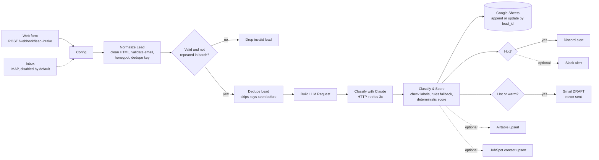

# n8n AI Lead Intake

An importable n8n workflow that answers one question fast: **"Is this new lead worth a reply right now?"**

A lead arrives from your website form or your inbox. n8n cleans it, drops repeats, asks Claude to label it,
scores it with fixed rules, saves it to Google Sheets, pings Discord when it is hot, and writes a **draft** reply
in Gmail for a person to check and send. Nothing is sent to the lead automatically.

> **Status:** portfolio / starter project. Both workflows pass the offline checks below and import cleanly into
> n8n 2.44.6. The intake-to-scoring part was also executed inside n8n 2.44.6 against a local fake Claude API
> (see *Offline checks*). The Sheets, Discord and Gmail steps have **not** been run against live accounts: that
> needs your own credentials. There are no usage numbers here because nobody has used it in production yet.

## The business problem

Enquiries often wait hours for a reply, and the good ones sit in the same queue as spam, job applications and
"what are your opening hours?". This workflow does the first sort for you within seconds of the lead arriving:

- every lead is logged in one sheet with intent, budget band, urgency and a 0-100 score
- hot leads raise an alert where your team already is (Discord, optionally Slack)
- a polite first reply is drafted, so answering is a review and a click, not a blank page
- spam and bots are flagged instead of reaching your inbox as "new client"

## How it works



A second workflow, **Lead Intake - Error Handler**, posts a short Discord message (workflow, failed node, error
text, no lead data) if the main workflow fails.

**The AI labels, the rules decide.** Claude returns `intent`, `budget_band`, `urgency`, a `summary` and a
`suggested_reply` as JSON. The **Classify & Score** node then:

1. checks each label against the allowed values in [`src/rules.json`](src/rules.json);
2. uses keyword rules for any label that is missing or invalid, or for all of them if the API call failed,
   so a lead is never lost because the model had a bad moment;
3. overrides the budget band with any amount the lead actually wrote (`$6,000`, `5k`, `USD 1500`);
4. adds fixed points: intent (up to 40) + budget (up to 35) + urgency (up to 25). Spam is always 0.
   Default tiers: **hot >= 70**, **warm >= 40**, otherwise cold.

The lead's message is treated as untrusted. The prompt tells the model not to follow instructions inside it,
the model can only pick from fixed labels, the score is computed in code, and every reply is a draft.

## Try it locally

You need Docker. The offline tests also need Python 3.10+ and, for the JavaScript checks, Node.js 18+.

```bash
cp .env.example .env              # then put a long random string in N8N_ENCRYPTION_KEY
docker compose up -d              # n8n on http://localhost:5678, create the owner account
docker compose exec n8n n8n import:workflow --separate --input=/workflows
```

Then in n8n:

1. Create credentials:
   - **Header Auth** for Claude: name `x-api-key`, value your Anthropic API key
   - **Google Sheets OAuth2** and **Gmail OAuth2**
   - **Discord Webhook** (one for leads, one for errors, or the same one)
2. Open each node with a red warning and select your credential.
3. Make a Google Sheet with a tab called `Leads` and paste the header row from
   [`docs/sheet-columns.csv`](docs/sheet-columns.csv).
4. In **Config**, set `sheet_id`, `sender_name`, `company_name`, and adjust the thresholds if you like.
5. In the main workflow, open **Settings → Error workflow** and pick **Lead Intake - Error Handler**.
6. Activate both workflows and send a sample lead:

```bash
curl -X POST http://localhost:5678/webhook/lead-intake -H "Content-Type: application/json" --data @harness/samples/01-hot-web-form.json
```

The sample files wrap the form fields in `body` (that is how n8n shows them to the Code node). When posting
from a real form, send just the fields: `name`, `email`, `company`, `phone`, `message`, `budget`, and an empty
hidden `website` field as the bot trap.

## What to customise

| What | Where |
|---|---|
| Hot / warm thresholds, model, Sheet ID, your name | **Config** node |
| Allowed labels, keyword rules, points, budget bands, fallback reply templates | `src/rules.json`, then `python scripts/build_workflows.py` |
| Prompt wording | `src/code_nodes/build_llm_request.js`, then rebuild |
| Form field names | `src/code_nodes/normalize_lead.js`, then rebuild |
| Read leads from email | enable **Email Lead (IMAP)** and add IMAP credentials |
| CRM | enable **Airtable Upsert** or **HubSpot Contact Upsert**, add credentials, map fields |
| Slack instead of Discord | enable **Slack Hot-Lead Alert**, disable the Discord node |
| Another LLM endpoint | change `llm_api_url` in Config and the request body in `build_llm_request.js` |

The Code node JavaScript lives in `src/code_nodes/` so it can be reviewed and tested as normal files.
`scripts/build_workflows.py` embeds it, with `src/rules.json`, into `workflows/*.json`. If you edit a Code node
inside n8n instead, export the workflow afterwards so the repo stays in sync.

## Offline checks

Nothing here calls a paid API or needs a network connection.

```bash
python -m unittest discover -s tests -v    # 55 tests, standard library only (pytest also works)
python scripts/validate_workflows.py       # static checks on workflows/*.json
python harness/run_samples.py              # demo table using saved fake Claude replies
python harness/run_samples.py --js         # same, running the workflow's own JavaScript in Node.js
```

What the tests cover:

- **Logic** (`tests/test_logic.py`): cleaning, honeypot and email checks, dedupe keys (also inside one batch), budget parsing and bands,
  keyword rules, score and tier edges, parsing Claude replies (fenced JSON, prose, API errors), and 8
  end-to-end cases from `harness/fixtures/cases.json`.
- **Same answers in JavaScript and Python** (`tests/test_js_parity.py`): runs the real Code node source from
  the workflow JSON in Node.js with stubbed `$input` / `$()` and compares every output with
  `lead_logic/logic.py`. Skipped if Node.js is not installed.
- **Workflow structure** (`tests/test_workflows.py` + `scripts/validate_workflows.py`): every connection
  points at a real node, every node is reachable from a trigger, required nodes exist, node types and versions
  exist in n8n 2.44.6, credentials are placeholders, no API keys / webhook URLs / tokens are hard-coded, the
  Gmail node can only create drafts, no node sends email by itself, and `workflows/` matches `src/`.
  Twelve tests break a copy of the workflow on purpose and check the validator catches it.

Two optional checks against a real n8n install (no Docker; each uses a throwaway data folder and makes no
outside network calls):

```bash
N8N_BIN=/path/to/node_modules/n8n/bin/n8n python scripts/n8n_import_check.py   # import both workflows
N8N_BIN=/path/to/node_modules/n8n/bin/n8n python scripts/n8n_smoke_test.py     # execute the main flow
```

The smoke test starts a fake Claude API on `127.0.0.1` that returns the saved replies, runs a copy of the main
workflow with a Manual Trigger feeding all 10 samples, and stops after **Classify & Score**. On n8n 2.44.6 it
gave: 10 leads in, 7 valid (bad email, honeypot and an in-batch repeat dropped), 7 API calls, all 7 results
identical to `lead_logic`, and **0** leads scored on the second run because Dedupe remembered them. That run
found one real bug that the unit tests could not: Dedupe only remembers *earlier* executions, so two copies of
the same lead in one batch both got through. **Normalize Lead** now catches those.

**Not covered:** the Google Sheets, Discord, Gmail, Slack, Airtable and HubSpot nodes, and a call to the real
Claude API. They need live accounts. Run one sample lead through after adding credentials and check each
node's output.

## Cost notes

- **n8n:** self-hosting with the Docker file here costs only the machine it runs on. n8n is fair-code
  (Sustainable Use License); check that it fits how you plan to use it. n8n Cloud is a paid alternative.
- **Claude:** the default model is `claude-haiku-5-5`, listed at $0.10 per million input tokens and $0.50 per
  million output tokens (Anthropic list price, October 2026; check the current pricing page). The prompt for the
  sample leads is about 1,100 characters (roughly 300 tokens). With the 4,000-character message cap and the
  `max_tokens: 1024` output cap, the **worst case is about $0.0007 per lead, or about $0.70 per 1,000 leads**.
  This is an estimate from those caps, not a measured bill.
- **Google Sheets, Gmail, Discord:** no extra cost at normal small-business volumes. Google API quotas apply.
- If the Claude call fails, the keyword rules still classify the lead, so an outage costs accuracy, not leads.

## Limits and known gaps

- Budget amounts are read as USD. Other currencies need a change in `parseBudget`.
- Dedupe history is stored by n8n per node (repeats inside one batch are caught in Normalize Lead). If a run fails after the dedupe step, retry it from the failed node
  in **Executions**, not by sending the lead again.
- The public webhook has no login, because a browser form cannot keep a secret. Protect it with the honeypot,
  a CAPTCHA on the form, and rate limits at your reverse proxy. If your own server posts the leads, switch the
  webhook to Header Auth.
- Keyword rules are English only.

## Project layout

```
workflows/            importable n8n JSON (built from src/)
src/code_nodes/       JavaScript for each Code node
src/rules.json        labels, keyword rules, points, tiers, reply templates
lead_logic/logic.py   Python copy of the Code node logic, for tests
scripts/              build, validate, optional n8n import check and smoke test
harness/              invented sample leads, fake Claude replies, Node.js runner for Code nodes
tests/                unittest suite
docs/                 Google Sheet header row
```

All names, companies and emails in `harness/` are invented. Domains use `.example` and `.test`.

## License

MIT, see [LICENSE](LICENSE).
